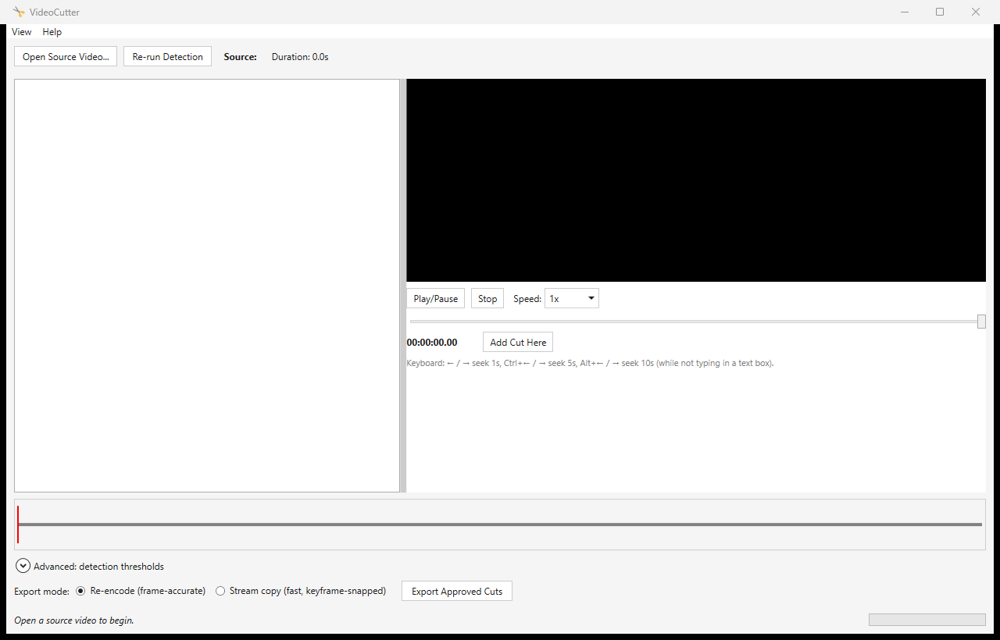

# VideoCutter

A Windows desktop tool for cutting commercial compilations: it makes a best-guess at cut points
(black frame / silence / scene-change detection via ffmpeg), lets you review each candidate as a
thumbnail with play-on-demand preview, tick/drag/retime the real ones, then exports every segment
between approved cuts as its own named clip.



## Features

- Best-guess cut detection (black frame + silence + scene-change), auto-approving only candidates
  **2+ detectors** agree on, so you review the ambiguous ones instead of everything.
- Thumbnail + timeline review: drag/retime/add/right-click-remove cuts, scrub and preview inline.
- Re-encode (frame-accurate) or stream-copy (fast) export, with automatic post-export
  verification and collision-safe auto-numbered naming.
- Autosave every 5s — a crash or accidental close never loses your review progress.
- 7 themes (including real Windows titlebar coloring), a video-right/video-top layout toggle,
  adjustable playback speed, and keyboard seeking.
- Robust logging and crash hardening — see `docs/ARCHITECTURE.md`.

**→ Full usage guide: [`docs/USER-MANUAL.md`](docs/USER-MANUAL.md)**
**→ Technical/architecture overview: [`docs/ARCHITECTURE.md`](docs/ARCHITECTURE.md)**

## Requirements

- Windows, .NET 10 SDK (`dotnet --list-sdks` should show `10.0.x`)
- PowerShell (for the ffmpeg fetch script)

## First-time setup

```
git clone https://github.com/jamesrobertcollins/VideoCutter.git
cd VideoCutter
powershell -ExecutionPolicy Bypass -File tools/Get-Ffmpeg.ps1   # fetches ffmpeg/ffprobe once
dotnet build VideoCutter.slnx
```

ffmpeg/ffprobe are **not** committed to git (ffmpeg.exe alone is ~140MB, over GitHub's
100MB file limit). The fetch script copies them from a local cache if present,
otherwise downloads a static Windows build. The build also runs this script automatically
before every build — but on a brand-new clone, run it once manually first, since MSBuild
evaluates the `Content` include condition before the auto-fetch target runs, so the very
first build won't see files that didn't exist yet when the project was loaded.

## Running

```
dotnet run --project src/VideoCutter.App/VideoCutter.App.csproj
```

See `docs/USER-MANUAL.md` for the full workflow (opening a file, reviewing candidates, exporting).

## Versioning

`Directory.Build.props` holds `VersionMajor`/`VersionMinor` (currently 1.0) — edited by hand, and
`VersionMajor` is bumped **only** on an explicit "major overhaul" instruction. The patch number is
*not* manual: a build target in `VideoCutter.App.csproj` shells out to `git rev-list --count HEAD`
and uses that commit count as the patch number automatically, so the version visible in About /
the exe's file properties always advances with every commit with zero upkeep.

## Licensing

VideoCutter's own code is MIT-licensed (`LICENSE`). It bundles/depends on third-party components
under their own licenses — **FFmpeg (GPLv3)** and **libvlc/LibVLCSharp (LGPL v2.1)** — invoked as
a separate process (ffmpeg/ffprobe) or dynamically-linked native library (libvlc), never
statically linked into VideoCutter.exe, so VideoCutter's own license is unaffected. Full details
are in [`THIRD-PARTY-NOTICES.md`](THIRD-PARTY-NOTICES.md); license texts are in `licenses/` and
`tools/ffmpeg/LICENSE.txt`. The About box (Help > About VideoCutter) has a **Third-Party
Licenses** button that opens this file directly.

## Project layout

- `src/VideoCutter.Core` — detection/export/verification engine (no UI dependencies).
- `src/VideoCutter.App` — WPF UI.
- `src/VideoCutter.SmokeTest` — headless console harness for the full pipeline without the GUI.
- `tools/Get-Ffmpeg.ps1` — fetches the bundled ffmpeg/ffprobe binaries.
- `docs/` — user manual and architecture overview.

See `docs/ARCHITECTURE.md` for how the pieces fit together.

## Contributing

See [`CONTRIBUTING.md`](CONTRIBUTING.md) — in particular, **documentation is expected to stay in
sync with every change**, not be cleaned up later.

## Changelog

See [`CHANGELOG.md`](CHANGELOG.md).

## Status

Core detect/export/verify pipeline has been exercised end-to-end against synthetic test clips:
real cut points are detected, correctly tagged by multiple detectors, pre-approved, exported, and
verified. The WPF UI builds and renders across all themes/layouts. It has not yet been driven
through a full manual review session against a real multi-hour VHS-capture compilation — do that
before trusting it on irreplaceable source footage.
