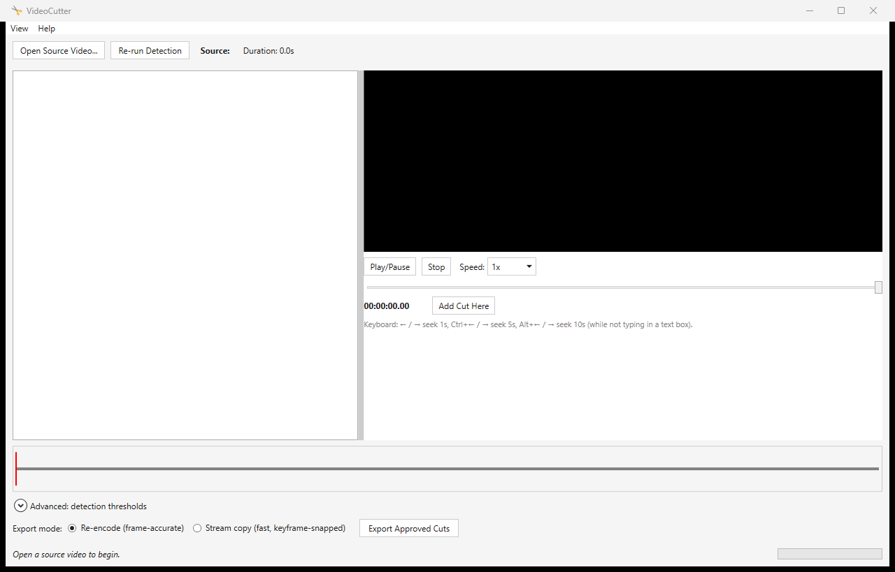

# VideoCutter User Manual

VideoCutter helps you turn a long commercial-compilation capture into separate, cleanly-named
clips: it makes a best guess at where the cuts should go, you review and adjust that guess, then
it exports every approved segment as its own file.

## 1. Opening a video

Click **Open Source Video...** (or **File > Open Source Video...**) and pick your file (mp4,
mkv, avi, mov, ts, m2ts, wmv). VideoCutter will:

1. Probe the file (duration, whether it has audio/video).
2. Look for a `<yourfile>.videocutter.json` sitting next to it — if one exists (e.g. from a
   previous session on this file), it resumes your prior edits instead of re-detecting.
3. Otherwise, run detection automatically. A popup tells you when detection has finished, so you
   know when the candidate list is ready to review — there's no need to guess or watch a spinner.

If your source has no audio track, you'll get a warning that silence detection is being skipped
for this file (black-frame and scene-change detection still run).

## 2. Understanding the candidate list

Every candidate cut point appears in the list on the left (or top, if you've switched layouts —
see below) with:

- A **thumbnail** of the frame at that point.
- A **checkbox** — checked candidates are the ones that will actually become cuts when you
  export. Candidates get pre-checked automatically ("best guess") when **two or more** independent
  detectors (black frame / silence / scene change) agree on roughly the same point; a cut flagged
  by only one detector — most often a plain scene-change, which also fires on ordinary quick cuts
  *inside* a single ad, not just between ads — starts unchecked for you to decide on.
- A **timecode** you can edit directly to nudge the exact position.
- Which detector(s) flagged it (Black / Silence / Scene / Manual).
- **Play** (jumps the preview to that point) and **✕** (removes the candidate) buttons.

### Reviewing and adjusting

- Click a thumbnail or its **Play** button to jump the preview there.
- **Tick/untick** checkboxes to approve or reject a candidate.
- **Drag a marker** on the timeline strip to nudge its position, or edit its timecode text box
  directly.
- **Right-click a timeline marker** to remove it instantly (handy for an accidental click).
- **Click empty space** on the timeline to add a manual cut at that position, or use **Add Cut
  Here** next to the scrubber to add one at the exact current playhead position.
- A **red line** on the timeline always shows where the preview is currently playing, so you can
  see how playback lines up against the candidate markers.

## 3. Playback controls

- **Play/Pause** and **Stop** control the embedded preview.
- The **scrubber** under the video lets you seek anywhere; the current timestamp is shown next to
  it.
- **Speed** dropdown (0.5x-4x) — speed up or slow down playback for faster review without
  changing pitch handling (this just changes playback rate).
- **Keyboard seeking** (works whenever you're not typing in a text box):
  | Keys | Seeks |
  |---|---|
  | ← / → | 1 second |
  | Ctrl + ← / → | 5 seconds |
  | Alt + ← / → | 10 seconds |

## 4. Layout

**View > Layout** switches between:
- **Video on Right** (default) — candidate list on the left, preview on the right with the
  larger share of the window.
- **Video on Top** — preview across the full width on top, candidate list filling the width
  below it.

Drag the splitter between the two panes to resize them further in either layout.

The **video preview itself is resizable**: drag the thin handle directly below the video area
(above the Play/Pause/Speed row) up or down to make the preview larger or smaller — handy if
you want to lean on a bigger picture when judging an edge-case cut point. It defaults to filling
most of the available vertical space already.

## 5. Thumbnail size

**View > Thumbnail Size** controls how big each candidate's thumbnail renders in the list:
Extra Small, Small, Medium (default), Large, or Extra Large. Your choice persists across
restarts. Larger sizes make individual frames easier to judge at a glance; smaller sizes let you
see more candidates at once without scrolling.

A small **scissors icon** sits next to the progress bar at all times and snips back and forth
whenever anything is running (detection, export, verification) — a quick visual confirmation the
app is still working and hasn't frozen, separate from the progress bar's own percentage.

## 6. Exporting

1. Pick an export mode:
   - **Re-encode (frame-accurate)** — every clip starts and ends at exactly the chosen point
     (libx264 + AAC). Slower, but precise.
   - **Stream copy (fast, keyframe-snapped)** — much faster, no re-encoding, but each cut snaps to
     the nearest keyframe, so the exact start/end can be off by up to a keyframe interval.
2. Click **Export Approved Cuts**. Every segment between two approved (checked) cuts — and the
   source start/end — becomes its own clip. The progress bar shows real completion (not just an
   animation): phase-by-phase during detection, per-clip during export/verification, and for
   re-encode mode specifically, a live percentage parsed from ffmpeg's own progress output as it
   encodes.
3. Clips land in the **same folder as the source**, named `OriginalName_00.mp4`, `_01.mp4`, and
   so on. Naming never overwrites: re-running export on a source whose `_00`/`_01`/... files
   already exist continues numbering from the next free index.
4. Each exported clip is **automatically verified** — non-zero duration, audio present if the
   source had audio, and that all the clip durations roughly sum back to the source's duration.
   When export finishes, a **results window** pops up with the pass/fail list, an **Open
   Folder** button to jump straight to where the clips landed, and a **Save List...** button to
   write the list out as a `.txt` or `.csv` file (handy for a record of what got cut from a long
   source). This window is a snapshot of that export — starting another export doesn't change
   what's already showing in an open results window.
5. **Delete project file after successful export** (checkbox next to Export Approved Cuts, off
   by default): once every exported clip passes verification, deletes the
   `<sourcename>.videocutter.json` autosave next to the source, since the review state is no
   longer needed once the real clips exist. Left alone if anything fails verification, so you can
   still review/retry. Your choice persists across restarts.

Your review state (which cuts are approved, any manual edits) **autosaves every 5 seconds** to
`<sourcename>.videocutter.json` next to the source file, so a crash or accidental close won't
lose your work — reopening the same source resumes exactly where you left off.

## 7. Themes

**View > Theme**: Light, Dark, Cyberpunk, Unix, Pink, Film (adds a filmstrip background image),
and Win9x. Your choice persists across restarts and also recolors the real Windows titlebar (on
Windows 11 build 22000+; older Windows keeps the default titlebar chrome).

## 8. Getting help / reporting a problem

- **Help > About VideoCutter** shows the exact version you're running, credits, and license info
  (including a **Third-Party Licenses** button covering ffmpeg/libvlc).
- **View > View Log** opens today's log file directly — it records every detection pass, every
  ffmpeg/ffprobe command run, and the full details of anything that goes wrong. If you hit a bug,
  this log is the most useful thing to attach to a bug report.
- VideoCutter is hardened to stay open and usable even when something goes wrong (a corrupted
  autosave file, a missing ffmpeg, etc.) — you'll get an error dialog rather than a silent crash,
  and the log will have the details either way.

## Tips

- If detection gives you far too many or too few candidates on a particular source, the
  **Advanced: detection thresholds** panel lets you adjust the black/silence/scene sensitivity
  and minimum segment length for that session without touching any config files.
- Stream-copy export is a good first pass for a quick preview of your cuts; switch to re-encode
  for the final pass once you're happy with the exact positions.
